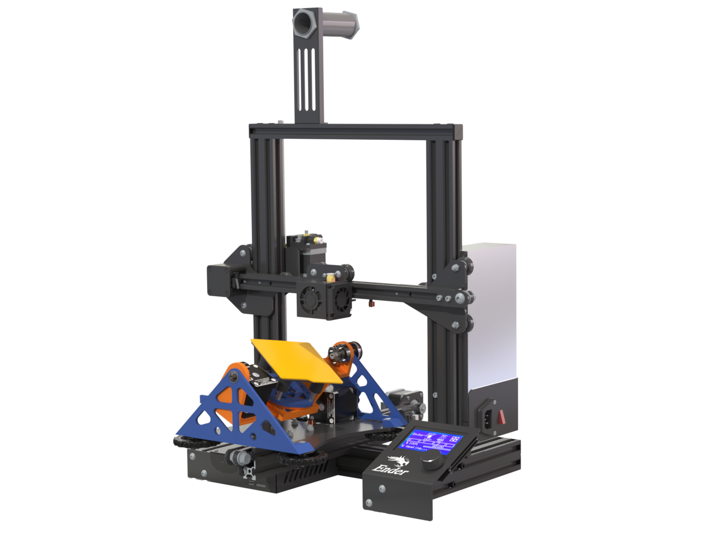

# Pentos

**Five-axis 3D printing on an Ender 3 V2.**

Pentos is a research prototype that adds a tilting, rotating heated bed to an
Ender 3 V2. Its browser-based slicer lets you print different sections of a
model at different angles or follow curved layers by moving the bed during
extrusion.

**[Try the slicer](#try-the-slicer)** · **[Build the retrofit](#build-the-retrofit)** · **[Assembly manual (PDF)](hardware/pentos-assembly-manual.pdf)**

<p align="center">
  
</p>

## Two ways to print

The original X, Y and Z motion is joined by **A-axis bed tilt** and **B-axis bed
rotation**. Both printing modes use the same slicer interface and hardware.

| Mode | What you define | How it prints |
| --- | --- | --- |
| **Multiplanar / indexed (3+2)** | Cutting planes that divide the model into sections | The bed changes orientation between sections and stays fixed while each section prints. |
| **Nonplanar / simultaneous five-axis** | Guide surfaces that shape the layers | The bed tilts and rotates during printing so deposition follows curved layers. |

## Try the slicer

You can explore the interface and load projects without connecting a printer.
To run the slicer on your computer, install **Python 3.13 or newer** and
**[uv](https://docs.astral.sh/uv/)**. Generating toolpaths also requires
`prusa-slicer` on your `PATH`.

```bash
git clone https://github.com/Evanston09/pentos-slicer.git
cd pentos-slicer
uv sync --locked
uv run python main.py
```

Open the URL printed in the terminal, normally **http://localhost:8080**.

1. Upload an STL, 3MF, OBJ or PLY model, or open a saved `.pentos` project.
2. Choose Multiplanar or Nonplanar, then edit the cutting planes or guide surfaces.
3. Set the machine profile and print settings, then slice.
4. Review extrusion, travel and rotary motion in the preview before downloading G-code.

The [slicer README](https://github.com/Evanston09/pentos-slicer#readme) covers
installation, Docker, example projects, settings and machine calibration.

## Build the retrofit

The documented retrofit uses an **Ender 3 V2**, a **90 × 90 mm heated tile**,
two additional NEMA 17 motors, belt drives and Hall-effect homing sensors.
Other Ender 3 variants and clones need their mounting geometry, clearances and
electronics checked before adapting the design.

1. Check the parts list before ordering. The prototype’s priced hardware was
   estimated at **$333 excluding the base printer**, before shipping and tax.
   [Download the bill of materials (CSV)](hardware/bom.csv).
2. Print the four plastic parts. Buy two **12 × 3 mm neodymium disc magnets**,
   and add pauses in the slicer. Check polarity before inserting each magnet,
   then resume printing to enclose it. [Open the hardware guide](hardware/README.md).
3. Assemble the retrofit and mount it to the Ender 3 V2’s Y gantry.
   [Open the illustrated assembly manual (PDF)](hardware/pentos-assembly-manual.pdf).

## Configure the printer

The prototype keeps the original Ender controller for X, Y, Z and extrusion,
adds a BTT SKR 1.4 Turbo for A/B motion and the heated tile, and runs both from
a shared Klipper host.

Use the prototype configuration as a starting point. Check the controller
serial paths, pins, driver settings, homing offsets, and travel limits against
your build. Measure the bed center and rotation pivots for the slicer’s machine
profile so it can adjust XYZ moves as the bed tilts and rotates.
[View the Klipper configuration](klipper_configs/printer.cfg).

Before printing, review the toolpath for collisions, unreachable moves, and
uneven layer thickness. Check alignment between sections during calibration
and set B-axis travel limits to protect the bed wiring from twisting.

## What the prototype demonstrated

In a 90-degree elbow comparison, indexed printing used no supports,
reduced total job time by **19.5%**, and reduced part-plus-support mass by
**29.0%** compared with planar printing. Each condition used three samples.
Nonplanar block prints showed fewer visible terrace boundaries in microscope
images. Mechanical strength was not tested.
